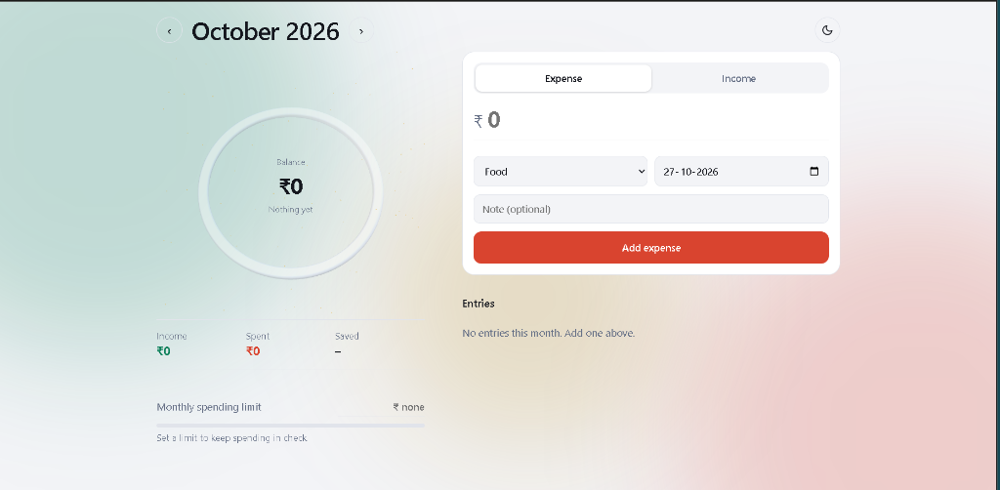

# 💰 Monthly Expense Tracker (MERN Stack)

A modern, 3D neumorphic/glassmorphic Monthly Expense Tracker built with MongoDB, Express, React, and Node.js. Designed to match the aesthetic reference with fluid animations and comprehensive business logics.



---

## 🌟 Key Features

1. **3D Neumorphic Balance Ring & Live Analytics**:
   - Embossed 3D circular progress gauge showing real-time balance, spending ratio, and status.
   - Ambient particle lighting and subtle depth shadows.
   - Instant count calculations for **Income**, **Spent**, and **Saved**.

2. **Monthly Spending Limit & Pacing (Business Logic)**:
   - Dynamic monthly budget limit setting.
   - Smart color-coded progress indicator (< 70% safe green, 70-95% warning amber, > 95% overbudget red).
   - Real-time remaining balance and pacing alerts.

3. **Transaction Management (CRUD)**:
   - Segmented Expense vs Income tab switch with spring animation.
   - Currency symbol `₹` with formatted amount input.
   - Categorized tagging with icons (Food, Transport, Bills, Shopping, Salary, etc.).
   - Date selection formatted as `DD-MM-YYYY`.
   - Optional note description.
   - Tactile 3D push-down CTA button with dynamic color theming.
   - Edit and Delete with smooth exit animations.

4. **Complete User Authentication & Data Isolation (Business Logic)**:
   - Full Register, Login, User Profile, and Logout flow.
   - Passwords encrypted with `bcryptjs` and authenticated via `jsonwebtoken` (JWT).
   - Strict data isolation: each user only accesses their own transactions and budgets.
   - User Profile Modal with account lifetime metrics (total transactions, all-time spend/income/savings).
   - **Instant 1-Click Demo Login** included (`demo@example.com` / `demo1234`).

5. **Financial Intelligence Modal**:
   - Average daily spending velocity.
   - Safe daily pacing recommendation (how much you can spend per day for the rest of the month).
   - Savings rate percentage (% of income saved).
   - Category-wise spending breakdown with visual progress meters.

5. **Monthly Navigation & Data Isolation**:
   - Browse across months (`< October 2026 >`).
   - All summaries, budgets, and entries are isolated and filtered by selected month.

6. **Export & Theme**:
   - One-click export to CSV spreadsheet.
   - Dark mode / Light mode toggle with ambient mesh background.

---

## 🏗️ Architecture

```
expense-tracker/
├── server/
│   ├── models/
│   │   ├── Transaction.js      # Mongoose Schema
│   │   └── Budget.js           # Monthly Budget Schema
│   ├── controllers/
│   │   ├── transactionController.js
│   │   └── budgetController.js
│   ├── routes/
│   │   └── api.js              # RESTful API endpoints
│   ├── data/
│   │   ├── fallbackStore.js    # Resilient JSON persistent backup store
│   │   └── store.json
│   ├── server.js               # Express entry point
│   └── package.json
│
├── client/
│   ├── src/
│   │   ├── components/
│   │   │   ├── Header.jsx          # Month picker & theme toggle
│   │   │   ├── BalanceRing.jsx     # 3D circular gauge
│   │   │   ├── SummaryCards.jsx    # Income, Spent, Saved
│   │   │   ├── SpendingLimit.jsx   # Budget progress & alerts
│   │   │   ├── TransactionForm.jsx # 3D form & segmented switcher
│   │   │   ├── TransactionList.jsx # Entries list with filters & CRUD
│   │   │   ├── EditModal.jsx       # Modal to edit entries
│   │   │   └── InsightsModal.jsx   # Business analytics & pacing
│   │   ├── utils/
│   │   │   └── formatters.js       # Rupee formatting & CSV export
│   │   ├── App.jsx
│   │   └── index.css               # Mesh gradients & 3D shadows
│   └── package.json
│
└── package.json
```

---

## 🚀 Quick Start

### 1. Install Dependencies
Run the following in the project root:
```bash
npm install
npm --prefix server install
npm --prefix client install
```

### 2. Start Both Backend & Frontend Concurrently
```bash
npm run dev
```

- **Frontend**: http://localhost:8080
- **Backend API**: http://localhost:5000

---

## 🗄️ Database Setup (MongoDB)

- The backend automatically connects to MongoDB at `mongodb://127.0.0.1:27017/expense_tracker` (or your MongoDB Atlas connection string in `server/.env`).
- **Resilient Fallback**: If MongoDB is not yet started, the server automatically uses a local persistent file store (`server/data/store.json`), meaning you can start and test the app immediately without any setup hurdles!
